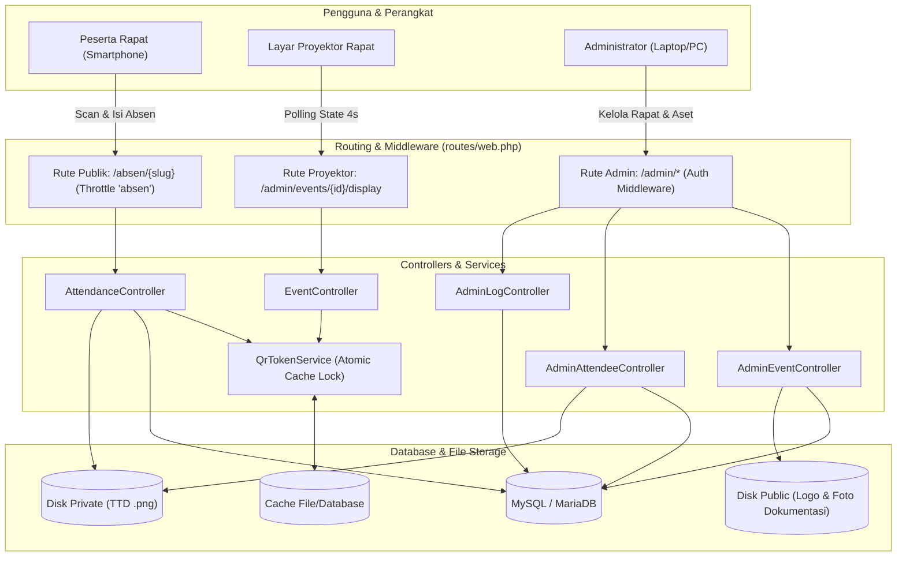

# Dokumen Analisis Struktur & Arsitektur Web "Rapatku"

> **Versi Dokumentasi:** 2.5 (As-Built & Optimized)  
> **Tanggal Pembaruan:** Oktober 2026  
> **Status Aplikasi:** Siap Produksi / Active Maintenance  
> **Studi Kasus:** Sistem Manajemen Rapat Formal, Absensi Berbasis QR Dinamis, Tanda Tangan Digital, Dokumentasi Foto, dan Ekspor Rekap Kedinasan (BNN).

---

## 1. Ringkasan Eksekutif & Filosofi Sistem

**Rapatku** adalah platform web terpadu yang dirancang untuk mendigitalkan seluruh siklus penyelenggaraan rapat dan kegiatan kedinasan: mulai dari pembuatan agenda, pemutaran QR dinamis di layar proyektor rapat, pengisian kehadiran langsung oleh peserta melalui perangkat seluler (smartphone) tanpa antrean, penandatanganan digital via layar sentuh (canvas), pengarsipan dokumentasi visual acara, hingga pencetakan dokumen daftar hadir resmi ber-tanda tangan (PDF dan Excel).

### Prinsip Desain Kunci:
1. **Zero Friction for Attendees:** Peserta rapat (internal staf maupun mitra luar) tidak perlu mengunduh aplikasi khusus atau mendaftarkan akun. Cukup pindai QR di proyektor, isi formulir, goreskan tanda tangan, dan selesai.
2. **Kemandirian Infrastruktur (Offline-First Assets):** Seluruh pustaka eksternal (Tailwind CDN, QRCode.js, SignaturePad) disimpan secara lokal di dalam folder `public/js/`. Aplikasi dapat beroperasi lancar tanpa ketergantungan CDN internet publik.
3. **Privasi & Keamanan Berlapis (UU PDP):** Berkas tanda tangan digital disimpan di dalam storage privat (`storage/app/private`) dan hanya dapat diakses melalui enkapsulasi route admin terotentikasi.
4. **Anti-Penyalahgunaan QR:** Menggunakan token berbasis waktu (rotating QR token) dengan mekanisme kunci cache atomik (*atomic lock*) dan toleransi jeda koneksi (*grace period*).
5. **Efisiensi Bandwidth & Performa Ringan:** Pemuatan aset telah dioptimalkan dengan kompresi otomatis (PHP GD), pemangkasan resolusi logo, dan *lazy loading* pada seluruh foto dokumentasi serta tanda tangan peserta.

---

## 2. Struktur Direktori Proyek

Berikut adalah peta struktur folder dan berkas proyek `rapatku`:

```text
rapatku/
├── app/
│   ├── Http/
│   │   ├── Controllers/
│   │   │   ├── AdminAttendeeController.php   # Kelola data peserta, update, hapus, stream TTD privat
│   │   │   ├── AdminAuthController.php       # Autentikasi admin, throttle login, catat activity log
│   │   │   ├── AdminEventController.php      # CRUD rapat, foto dokumentasi, settings logo/bg, export
│   │   │   ├── AdminLogController.php        # Audit trail aktivitas admin & login history
│   │   │   ├── AttendanceController.php      # Alur publik absensi peserta, validasi token, simpan TTD
│   │   │   ├── Controller.php                # Base Laravel controller
│   │   │   └── EventController.php           # Tampilan proyektor (display QR) & API state polling
│   ├── Models/
│   │   ├── ActivityLog.php                   # Model log aktivitas sistem & riwayat audit
│   │   ├── Attendee.php                      # Model peserta rapat, normalisasi nomor telepon, UUID
│   │   ├── Category.php                      # Model kategori rapat (internal, eksternal, dll.)
│   │   ├── Event.php                         # Model utama rapat/kegiatan, UUID v7, relasi foto & peserta
│   │   ├── EventPhoto.php                    # Model 5 slot foto dokumentasi kegiatan rapat
│   │   ├── Signatory.php                     # Model daftar pejabat penandatangan dokumen dinas
│   │   └── User.php                          # Model akun administrator
│   ├── Providers/
│   │   └── AppServiceProvider.php            # Rate limiter 'absen', view composer logo global, pagination
│   └── Services/
│       └── QrTokenService.php                # Layanan kalkulasi & rotasi token QR dengan cache lock
├── bootstrap/
│   └── app.php                               # Konfigurasi middleware, exceptions, dan booting Laravel 12
├── config/                                   # Konfigurasi aplikasi (auth, cache, database, filesystems, dll.)
├── database/
│   ├── factories/                            # Factory dummy data untuk pengujian
│   ├── migrations/                           # 12 berkas skema migrasi database
│   └── seeders/                              # Database seeder (akun default admin, kategori awal)
├── note/                                     # Arsip dokumentasi arsitektur, audit, dan pedoman teknis
│   ├── analisis_struktur_web.md              # [Dokumen ini] Analisis arsitektur lengkap terkini
│   ├── architecture.md                       # Catatan rancangan awal sistem
│   ├── Architecture v2_ Sistem Absensi...    # Spesifikasi kebutuhan versi 2
│   ├── audit.md                              # Log audit keamanan dan pengujian performa
│   └── rate_limiter_dan_concurrency.md       # Catatan teknis pengamanan rate limit & race condition
├── public/
│   ├── images/                               # Aset visual default (logo BNN, placeholder default)
│   ├── js/
│   │   ├── qrcode.min.js                     # Pustaka QR Code client-side (offline)
│   │   ├── signature_pad.min.js              # Pustaka HTML5 Canvas digital signature (offline)
│   │   └── tailwindcdn.js                    # Pustaka Tailwind styling lokal (tanpa build step runtime)
│   ├── storage -> ../storage/app/public      # Symlink ke storage publik
│   ├── .htaccess                             # Konfigurasi Apache rewrite engine
│   └── index.php                             # Front controller entry point aplikasi
├── resources/
│   └── views/
│       ├── admin/
│       │   ├── events/
│       │   │   ├── index.blade.php           # Daftar rapat (tabel ringkas)
│       │   │   ├── show.blade.php            # Detail rapat, upload foto dokumentasi, tabel peserta
│       │   │   └── rekap.blade.php           # Halaman cetak daftar hadir resmi / PDF view
│       │   ├── logs/
│       │   │   └── index.blade.php           # Tampilan tabel audit trail log aktivitas & riwayat login
│       │   ├── dashboard.blade.php           # Dasbor admin utama, statistik, pencarian rapat, quick modal
│       │   └── settings.blade.php            # Kelola logo, background login, kategori, penandatangan, akun
│       ├── attendance/
│       │   ├── closed.blade.php              # Tampilan saat rapat dinonaktifkan / absensi ditutup
│       │   ├── expired.blade.php             # Tampilan saat token QR kedaluwarsa
│       │   ├── form.blade.php                # Formulir input data peserta & canvas tanda tangan jari
│       │   └── success.blade.php             # Halaman konfirmasi kehadiran berhasil tercatat
│       ├── auth/
│       │   └── login.blade.php               # Halaman login administrator dinamis (custom background)
│       ├── event/
│       │   └── display.blade.php             # Tampilan layar proyektor (QR dinamis + live counter)
│       └── layouts/
│           ├── admin.blade.php               # Master layout panel administrasi (sidebar navigasi)
│           └── app.blade.php                 # Master layout halaman publik / formulir peserta
├── routes/
│   ├── console.php                           # Perintah artisan konsol khusus
│   └── web.php                               # Definisi seluruh rute aplikasi (publik & admin)
└── storage/
    ├── app/
    │   ├── private/events/{slug}/signatures/ # Penyimpanan file tanda tangan peserta (PRIVAT)
    │   └── public/                           # Penyimpanan berkas publik (foto dokumentasi, logo custom)
    ├── framework/                            # Cache compiled blade views, sessions, cache data
    └── logs/                                 # Log debug aplikasi (`laravel.log`)
```

---

## 3. Komponen Arsitektur Utama (MVC + Services)



### 3.1 Kontroler (Controllers)
- **`AttendanceController`**: Menangani siklus hidup kehadiran peserta. Memvalidasi ketersediaan event (`is_active`), memverifikasi validitas token QR via `QrTokenService`, mencegah pengisian ganda berdasarkan kombinasi unik nomor telepon per rapat, melakukan decode gambar canvas Base64, dan menyimpannya ke disk privat.
- **`EventController`**: Mengatur tampilan layar proyektor rapat (`display.blade.php`) dan melayani request AJAX polling status (`/admin/events/{event}/state`) untuk memperbarui token QR dan menghitung jumlah kehadiran (*live counter*).
- **`AdminEventController`**: Pusat kendali agenda rapat. Mengatur pembuatan acara baru dengan generate slug otomatis, pencarian agenda, toggle status aktif/tutup, unggah foto dokumentasi (maks 5 foto), auto-resize & kompresi logo instansi via PHP GD, export CSV/Excel, serta kustomisasi background login.
- **`AdminAttendeeController`**: Mengelola daftar peserta terdaftar, pengubahan data nama/divisi/instansi, penghapusan data salah input, dan *streaming* aman gambar tanda tangan peserta dari disk privat ke panel admin.
- **`AdminLogController`**: Menampilkan audit trail aktivitas sistem (riwayat login admin, tindakan CRUD penting, alamat IP, dan User Agent) serta fitur pembersihan log (*purge logs*).
- **`AdminAuthController`**: Menangani proses otentikasi admin dengan rate-limiting ketat (maksimal 5 percobaan per menit) serta pencatatan otomatis ke tabel `activity_logs`.

### 3.2 Model & Relasi Data
1. **`Event`**:
   - Primary Key: `id` (bigint), didukung `uuid` (UUIDv7 string untuk identifikasi rute publik/admin).
   - Relasi: `hasMany(Attendee::class)`, `hasMany(EventPhoto::class)`.
   - Kolom Snapshot Penandatangan: `nama_penandatangan`, `jabatan_penandatangan`, `nip_penandatangan` agar dokumen rekap masa lalu tidak berubah meskipun data master pejabat diperbarui.
2. **`Attendee`**:
   - Relasi: `belongsTo(Event::class)`.
   - Menggunakan UUIDv7 untuk penyajian gambar tanda tangan (`/admin/attendees/{uuid}/signature`).
   - Normalisasi nomor telepon otomatis (`preg_replace('/\D/', '', $raw)`) untuk memastikan format digit murni.
3. **`EventPhoto`**:
   - Relasi: `belongsTo(Event::class)`.
   - Menyimpan metadata foto dokumentasi (`path`, `original_name`, `size`, `mime_type`, `sort_order`).
   - Aksesor ramah pengguna: `human_size` (KB/MB), `ext`, dan `is_portrait`.
4. **`Signatory`**:
   - Master data pejabat penandatangan dokumen (Nama, Jabatan, NIP/NRP, status aktif).
   - Dilengkapi *SoftDeletes* agar riwayat penandatangan tidak merusak integritas data lama.
5. **`Category`**:
   - Kategori rapat dinamis (misal: Rapat Internal, Rapat Koordinasi Mitra, Sosialisasi).
6. **`ActivityLog`**:
   - Mencatat setiap aktivitas krusial beserta konteks IP address, user agent, dan metadata JSON `properties`.

### 3.3 Layanan Khusus (Services)
- **`QrTokenService`**:
  - Mengelola token dinamis yang disematkan pada QR Code.
  - Menggunakan `Cache::lock` atomik berdurasi 5 detik untuk mencegah *race condition* saat banyak klien merefresh layar proyektor secara bersamaan.
  - Menyimpan token aktif (`current`), token sebelumnya (`prev`), dan token cadangan (`prev2`). Mekanisme toleransi 30–45 detik ini memastikan peserta yang memindai QR tepat pada detik-detik pergantian token tidak mengalami *error expired*.

---

## 4. Skema Database & Relasi Tabel

Aplikasi menggunakan 7 tabel bisnis utama:

| Nama Tabel | Deskripsi | Kunci Utama / Unik | Indeks Penting |
|---|---|---|---|
| **`users`** | Akun administrator sistem | `id` (PK), `email` (Unique) | `email` |
| **`events`** | Agenda rapat dan konfigurasi sesi | `id` (PK), `uuid` (Unique), `slug` (Unique) | `uuid`, `slug`, `event_date`, `is_active` |
| **`attendees`** | Data kehadiran & tanda tangan peserta | `id` (PK), `uuid` (Unique), `(event_id, no_telp)` (Unique) | `event_id`, `uuid`, `created_at` |
| **`event_photos`** | Dokumentasi visual kegiatan (maks 5) | `id` (PK) | `event_id`, `sort_order` |
| **`categories`** | Master kategori agenda rapat | `id` (PK), `name` (Unique) | `name` |
| **`signatories`** | Master data pejabat penandatangan | `id` (PK) | `is_active`, `deleted_at` |
| **`activity_logs`** | Audit trail aktivitas & riwayat login | `id` (PK) | `user_id`, `activity`, `created_at` |

### Integritas Data & Aturan Penghapusan:
- Menghapus record pada `events` akan secara otomatis mengeksekusi `CASCADE DELETE` pada seluruh `attendees` dan `event_photos` terkait, sehingga database terbebas dari *orphan records*.
- Berkas fisik tanda tangan dan foto dokumentasi pada storage dibersihkan oleh controller saat aksi hapus dipicu.

---

## 5. Matriks Routing Lengkap (`routes/web.php`)

| Metode | URI | Nama Route | Kontroler & Aksi | Hak Akses |
|---|---|---|---|---|
| `GET` | `/` | - | Redirect ke `/login` | Publik |
| `GET` | `/login` | `login` | `AdminAuthController@showLogin` | Tamu |
| `POST` | `/login` | `login.post` | `AdminAuthController@login` (throttle: 5,1) | Tamu |
| `POST` | `/logout` | `logout` | `AdminAuthController@logout` | Admin |
| `GET` | `/absen/{slug}` | `absen.create` | `AttendanceController@create` | Peserta |
| `POST` | `/absen/{slug}` | `absen.store` | `AttendanceController@store` (throttle: absen) | Peserta |
| `GET` | `/absen/{slug}/sukses` | `absen.success` | `AttendanceController@success` | Peserta |
| `GET` | `/manifest.json` | `manifest` | `AdminEventController@manifest` | Publik / PWA |
| `GET` | `/admin` | `admin.dashboard` | `AdminEventController@dashboard` | Admin (Auth) |
| `GET` | `/admin/events` | `admin.events.index` | `AdminEventController@index` | Admin (Auth) |
| `POST` | `/admin/events` | `admin.events.store` | `AdminEventController@store` | Admin (Auth) |
| `GET` | `/admin/events/{event}` | `admin.events.show` | `AdminEventController@show` | Admin (Auth) |
| `PATCH` | `/admin/events/{event}/toggle` | `admin.events.toggle` | `AdminEventController@toggle` | Admin (Auth) |
| `DELETE` | `/admin/events/{event}` | `admin.events.destroy` | `AdminEventController@destroy` | Admin (Auth) |
| `GET` | `/admin/events/{event}/display` | `admin.events.display` | `EventController@display` | Admin (Auth) |
| `GET` | `/admin/events/{event}/state` | `admin.events.state` | `EventController@state` | Admin (Auth) |
| `GET` | `/admin/events/{event}/rekap` | `admin.events.rekap` | `AdminEventController@rekap` | Admin (Auth) |
| `POST` | `/admin/events/{event}/signatory`| `admin.events.signatory.update` | `AdminEventController@updateSignatorySnapshot` | Admin (Auth) |
| `GET` | `/admin/events/{event}/export-excel` | `admin.events.export-excel` | `AdminEventController@exportExcel` | Admin (Auth) |
| `POST` | `/admin/events/{event}/photos` | `admin.events.photos.store` | `AdminEventController@storePhoto` | Admin (Auth) |
| `DELETE` | `/admin/events/{event}/photos/{photo}` | `admin.events.photos.destroy` | `AdminEventController@destroyPhoto` | Admin (Auth) |
| `PUT` | `/admin/attendees/{attendee}` | `admin.attendees.update` | `AdminAttendeeController@update` | Admin (Auth) |
| `DELETE` | `/admin/attendees/{attendee}` | `admin.attendees.destroy` | `AdminAttendeeController@destroy` | Admin (Auth) |
| `GET` | `/admin/attendees/{attendee}/signature` | `admin.attendees.signature` | `AdminAttendeeController@signature` | Admin (Auth) |
| `GET` | `/admin/settings` | `admin.settings.index` | `AdminEventController@settings` | Admin (Auth) |
| `POST` | `/admin/settings/logo` | `admin.settings.logo.update` | `AdminEventController@updateLogo` | Admin (Auth) |
| `DELETE` | `/admin/settings/logo` | `admin.settings.logo.destroy` | `AdminEventController@destroyLogo` | Admin (Auth) |
| `POST` | `/admin/settings/login-background` | `admin.settings.login-background.update` | `AdminEventController@updateLoginBackground` | Admin (Auth) |
| `DELETE` | `/admin/settings/login-background` | `admin.settings.login-background.destroy` | `AdminEventController@destroyLoginBackground` | Admin (Auth) |
| `GET` | `/admin/logs` | `admin.logs.index` | `AdminLogController@index` | Admin (Auth) |
| `DELETE` | `/admin/logs` | `admin.logs.destroy` | `AdminLogController@destroyAll` | Admin (Auth) |

---

## 6. Aspek Keamanan & Mitigasi Risiko

1. **Privasi Tanda Tangan Digital (Signature Encapsulation):**
   - Berkas tanda tangan disimpan pada folder `storage/app/private/events/{slug}/signatures/{id}.png`.
   - File ini **tidak memiliki URL publik** dan tidak terjangkau oleh direktori `public/storage`.
   - Hanya admin dengan sesi aktif yang dapat melihat gambar melalui route terproteksi `admin.attendees.signature`.
2. **Rate Limiting Bertingkat (Dual-Tier Throttle):**
   - Masalah umum sistem absensi pada satu ruangan rapat adalah seluruh peserta menggunakan satu koneksi Wi-Fi (IP publik yang sama). Jika limit IP ketat (misal 10 req/menit), peserta lain akan terblokir.
   - Solusi Rapatku:
     - **Limit per IP:** Dibuat longgar (**150 request / menit**) untuk mengakomodasi puluhan HP di satu jaringan Wi-Fi.
     - **Limit per Nomor Telepon:** Dibuat ketat (**3 request / menit**) untuk memblokir bot / pengisian formulir spam berulang dari individu yang sama.
3. **Pemberian Izin Berbasis Token & Session:**
   - Saat peserta memindai QR code (`/absen/{slug}?t={token}`), server memverifikasi token terhadap `QrTokenService`.
   - Jika sah, server menyematkan izin sesi (`session(['event_access_' . $event->id => true])`) berdurasi 20 menit.
   - Jika seseorang mencoba membuka link tanpa scan QR yang valid, akses akan ditolak dengan halaman `expired` (403).
4. **Proteksi Enumerasi ID via UUID:**
   - Parameter URL publik dan route admin menggunakan format UUIDv7 alih-alih ID numerik urut (`1, 2, 3`), mencegah pihak luar menebak URL rapat atau data peserta lain.

---

## 7. Optimasi Performa & Penanganan Bottleneck

Berdasarkan audit teknis dan pemantauan log traffic, sejumlah optimasi krusial telah diterapkan:

1. **Kompresi & Resize Otomatis Logo Aplikasi:**
   - *Masalah Sebelumnya:* File logo yang diunggah berukuran **1.08 MB (1254x1254 px)** dimuat berulang kali untuk favicon dan sidebar icon (36x36 px), memakan waktu transfer 1–2 detik di jaringan lokal/tunnel.
   - *Solusi Terpasang:* Ditambahkan sistem kompresi otomatis berbasis PHP GD pada [AdminEventController.php](file:///d:/Dokumen%20Tugas%20Kuliah/portofolio/rapatku/rapatku/app/Http/Controllers/AdminEventController.php). Logo otomatis dipangkas maksimal ke **320x320 px** dengan kompresi PNG level 9. Ukuran berkas terpangkas drastis dari **1.080 KB menjadi 63 KB** (**turun 94%**), sehingga waktu muat menjadi instan (<50 ms).
2. **Penerapan Native Lazy Loading:**
   - Seluruh foto dokumentasi rapat (5 slot) dan gambar tanda tangan pada tabel peserta di [resources/views/admin/events/show.blade.php](file:///d:/Dokumen%20Tugas%20Kuliah/portofolio/rapatku/rapatku/resources/views/admin/events/show.blade.php) telah dilengkapi atribut `loading="lazy"`.
   - Browser tidak lagi mendownload belasan megabyte foto secara bersamaan saat pertama kali membuka halaman, menghemat kuota dan membebaskan antrean server built-in PHP.
3. **Pencegahan Race Condition pada Pencarian:**
   - Input pencarian pada dasbor dan tabel menggunakan form submit terarah atau filter berbasis event submit, bukan *instant polling per-keystroke*, menghilangkan potensi tabrakan request (*request flooding*) yang membebani database.
4. **Pencegahan Double-Submit Form:**
   - Tombol upload foto dan tombol submit absensi dilengkapi mekanisme *loading state* (tombol otomatis *disabled* dan menampilkan teks "Mengunggah..." begitu ditekan) untuk mencegah pengguna mengeklik berkali-kali saat koneksi lambat.

---

## 8. Panduan Pemeliharaan & Prosedur Operasional

### 8.1 Menjalankan Aplikasi Secara Lokal
```bash
# 1. Menjalankan web server lokal
php artisan serve --port=8000

# 2. (Opsional) Membuka tunnel untuk pengujian perangkat mobile
ngrok http 8000
```

### 8.2 Perintah Pemeliharaan Rutin (Artisan)
```bash
# Membersihkan seluruh cache saat memperbarui tampilan Blade
php artisan view:clear
php artisan cache:clear
php artisan config:clear

# Menautkan storage publik (wajib dieksekusi sekali di lingkungan baru)
php artisan storage:link

# Memeriksa status tabel migrasi
php artisan migrate:status
```

### 8.3 Pembersihan Berkas & Log
- Log aktivitas sistem dapat dibersihkan langsung oleh Administrator melalui tombol **"Kosongkan Semua Log"** di menu `/admin/logs`.
- Berkas tanda tangan digital tersimpan di `storage/app/private/events/`. Disarankan untuk melakukan *backup* folder ini secara berkala bersamaan dengan *dump* database MySQL.

---

*Dokumen ini disusun sebagai panduan teknis resmi arsitektur perangkat lunak Rapatku untuk keperluan portofolio, audit kode, dan pemeliharaan berkelanjutan.*
